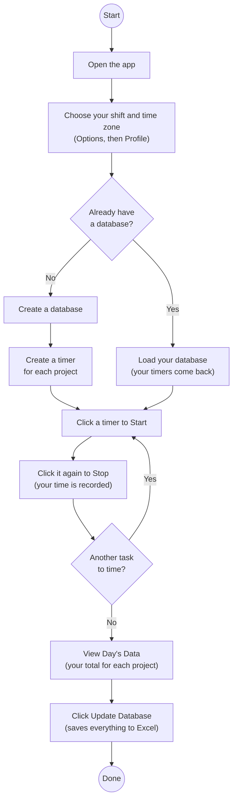

# ⏱️ Project Time Tracker

> Make accurate project billing a breeze. Save yourself tedious work while keeping labor within budget.


## ℹ️ About

Project Time Tracker is a simple desktop program that helps both day and night shift users accurately keep track of how much time they've spent on each project in a single work day.

Users simply create a database, create a timer for each project, press Start and Stop as they work, check their totals for the day, and save everything to an Excel "database" when done.

Accurate project billing was introduced at my company and the only solution my coworkers had was to manually type call logs into Excel sheets - needless to say this got old fast. So I took it upon myself to create this software to reduce this tedious, multi-step process into a 2-click solution.

This program has helped my coworkers and I immensely and I hope it helps you too!

_Disclaimer: Since I originally created this program for the company I work at, there are only 3 time-zones to match our needs: Central, Eastern, and Vietnam. This will change with future updates._

## 🌟 Highlights

- **Timer per project**: Create timers for every single project you're apart of.

- **Store logs in a familiar tool**: You store your every daily log into a "database", aka a regular Excel sheet. No complex SQLite databases needed.

## ✍️ Authors

Built by [@adrianelowerycoding](https://github.com/adrianelowerycoding).

## 🚀 Usage

Launch the app:

```

py -m project_timer

```

Here are the steps you follow to track your time:



## ⬇️ Installation

_If you need further help, the repo contains an Instructions guide._

**You'll need:** Windows and [Python 3.10 or newer](https://www.python.org/downloads/) (during install, tick "Add Python to PATH").

```

git clone https://github.com/adrianelowerycoding/Project-Timer.git

cd Project-Timer

py -m pip install -r requirements.txt

```

Prefer double-clicking? Run `setup.bat` once, then open `project_time_tracker.py`.

## 🧰 Tech Stack

| Tool | What it's used for |
|---|---|
| **Python 3.10+** | The programming language |
| **Tkinter** | The windows, buttons and timers (it comes with Python) |
| **openpyxl** | Reading and writing the Excel file |
| **zoneinfo + tzdata** | Converting between time zones, including daylight saving |
| **pytest** | Automated tests |
